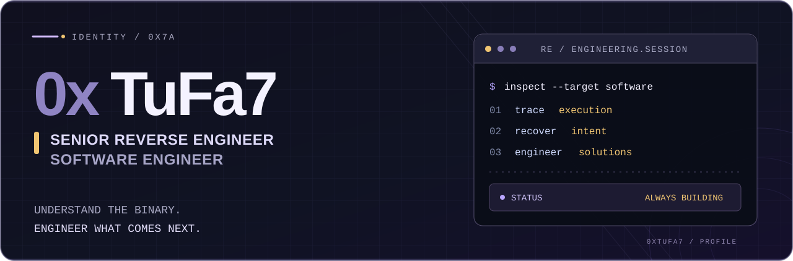

<!-- 0xTuFa7 • designed for GitHub's Markdown renderer -->

<div align="center">
  
</div>

<br>

<div align="center">
  <a href="https://xtufa7.github.io/">
    
  </a>
  &nbsp;
  <a href="https://github.com/xtufa7">
    
  </a>
  &nbsp;
  <a href="https://guns.lol/xtufa7">
    
  </a>
</div>

<br>

<table>
<tr>
<td width="60%" valign="top">

### `>_` ABOUT THE ENGINEER

**Nour Al-Shammari** &nbsp;·&nbsp; `@xtufa7`

I work at the intersection of **reverse engineering** and **software engineering** — breaking complex software down to understand its behavior, then turning that understanding into things worth building.

```text
┌─ CURRENT CONTEXT ───────────────────┐
│  Reverse engineering   • primary   │
│  Software engineering  • primary   │
│  PATTERON              • building  │
│  After Effects         • creative  │
└─────────────────────────────────────┘
```

<sub>University of Hail · 4th year</sub>

</td>
<td width="40%" valign="middle" align="center">

<a href="https://tenor.com/view/shizuku-hunter-x-hunter-gif-11152829">
  
</a>

<sub>SHIZUKU.EXE — STILL RUNNING</sub>

</td>
</tr>
</table>

<br>

### `01` / ENGINEERING DOMAINS

<table>
<tr>
<td width="50%" valign="top">

**`0x01` &nbsp; REVERSE ENGINEERING**

> Read the behavior. Find the logic. Understand the internals.

`Binary Analysis` · `Static / Dynamic Analysis` · `Debugging` · `Software Internals` · `Defensive Research`

</td>
<td width="50%" valign="top">

**`0x02` &nbsp; SOFTWARE ENGINEERING**

> Build with intention. Make systems understandable, usable, and reliable.

`Software Design` · `Systems Thinking` · `Developer Tooling` · `Automation` · `Problem Solving`

</td>
</tr>
</table>

### `02` / ON THE WORKBENCH

```text
   DISCOVER                    UNDERSTAND                    CREATE
   ─────────  ──────────────►  ───────────  ──────────────►  ─────────
   inspect                     deconstruct                   engineer
   trace                       map behavior                  iterate
   question                    verify assumptions            ship
```

**PATTERON** &nbsp; `EXPERIMENTAL`  
A project in progress. Built through curiosity, iteration, and plenty of time under the hood.

<br>

<div align="center">
  <sub>─────────────── &nbsp; CONTRIBUTION LOG / KEEP SCROLLING &nbsp; ───────────────</sub>
</div>

<br>

<!-- Original contribution and snake artwork left unchanged. -->
<div align="center">
  
  <br><br>
  
</div>
