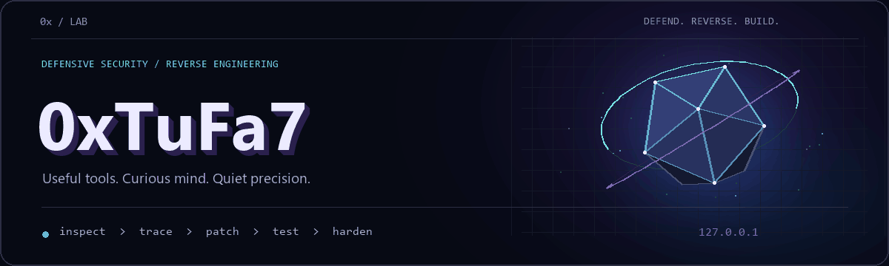

  

  
<b>Defensive security · Reverse engineering · Android analysis</b> I build practical tools and trace how software works.

  
<code>C# / .NET</code> · <code>TypeScript</code> · <code>Python</code> · <code>Flutter</code> · <code>Android</code>

  <a href="https://x.com/0xtufa7">X</a> · <a href="https://instagram.com/_bb5bb">Instagram</a> · <a href="https://github.com/xtufa7?tab=repositories">All projects ↗</a>

### Selected builds

<table>
<tr>
<td width="50%"><b>✦ <a href="https://github.com/xtufa7/NOVA-New-Tab">NØVA</a></b> A custom browser workspace: clock, music, terminal &amp; widgets.</td>
<td width="50%"><b>🐈 <a href="https://github.com/xtufa7/KittyGram">KittyGram</a></b> Android Instagram patches for privacy &amp; everyday improvements.</td>
</tr>
<tr>
<td width="50%"><b>⌨ <a href="https://github.com/xtufa7/LayFix">LayFix</a></b> Fix Arabic ↔ English keyboard-layout mistakes instantly.</td>
<td width="50%"><b>⚡ <a href="https://github.com/xtufa7/LiteBar">LiteBar</a></b> Windows tray controls for cleanup, power &amp; shortcuts.</td>
</tr>
<tr>
<td width="50%"><b>◉ <a href="https://github.com/xtufa7/LiteReplay">LiteReplay</a></b> Save the last 30–120 seconds of your desktop to a local MP4.</td>
<td width="50%"><b>◈ <a href="https://github.com/xtufa7/Secdeck">SecDeck</a></b> Linux security learning, offline simulations &amp; terminal tools.</td>
</tr>
<tr>
<td width="50%"><b>💸 <a href="https://github.com/xtufa7/ExpenseFlow">ExpenseFlow</a></b> Personal expenses, budgets &amp; savings in a Flutter app.</td>
<td width="50%"><b>⚙ <a href="https://github.com/xtufa7/Administration-Bot">Administration Bot</a></b> Discord staff management, hiring &amp; interviews.</td>
</tr>
</table>

More from the lab

- [Onion Domain Generator](https://github.com/xtufa7/onion-domain-generator) — a Tor hidden-service setup guide.
- [Web portfolio](https://github.com/xtufa7/xtufa7.github.io) — my personal website repository.
- [Still artwork](./assets/core-still.png) — a motion-free version of the header.

DEFEND · REVERSE · BUILD · HARDEN

