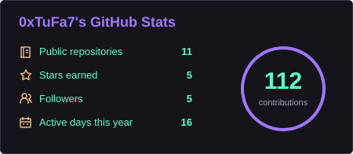
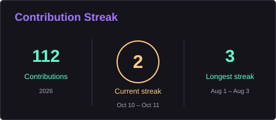
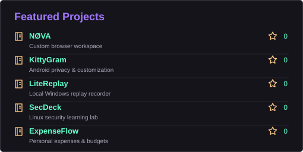
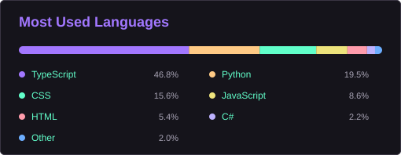

## 📊 GitHub Stats

  
  
    
  
    
  

  <a href="https://github.com/xtufa7/NOVA-New-Tab">NØVA</a> · <a href="https://github.com/xtufa7/KittyGram">KittyGram</a> · <a href="https://github.com/xtufa7/LayFix">LayFix</a> · <a href="https://github.com/xtufa7/LiteBar">LiteBar</a> 
  <a href="https://github.com/xtufa7/LiteReplay">LiteReplay</a> · <a href="https://github.com/xtufa7/Secdeck">SecDeck</a> · <a href="https://github.com/xtufa7/ExpenseFlow">ExpenseFlow</a> · <a href="https://github.com/xtufa7/Administration-Bot">Administration Bot</a>

  

---

  
   
  Defensive Security · Reverse Engineering · Android Analysis 
  <a href="https://x.com/0xtufa7">X</a> · <a href="https://instagram.com/_bb5bb">Instagram</a> · <a href="https://github.com/xtufa7?tab=repositories">All projects</a>

