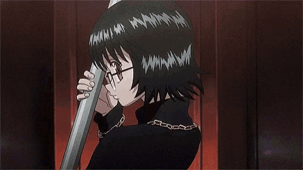
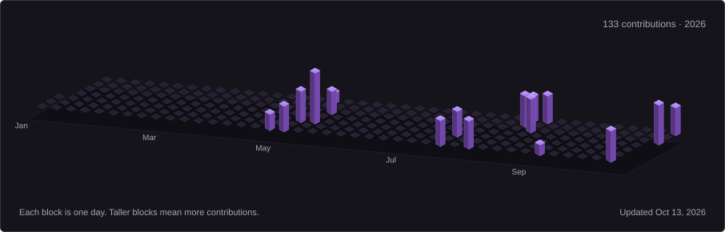

<div align="center">

<sub>REVERSE ENGINEERING &nbsp; / &nbsp; SOFTWARE ENGINEERING</sub>

# 0xTuFa7

**Senior Reverse Engineer · Software Engineer**

<sub>Understanding software from the inside out. Building tools that make complex systems easier to reason about.</sub>

<br><br>

<a href="https://xtufa7.github.io/"><strong>Website ↗</strong></a>
&nbsp;&nbsp;·&nbsp;&nbsp;
<a href="https://github.com/xtufa7"><strong>GitHub ↗</strong></a>
&nbsp;&nbsp;·&nbsp;&nbsp;
<a href="https://guns.lol/xtufa7"><strong>guns.lol ↗</strong></a>

</div>

---

### Engineering focus

<table>
<tr>
<td width="50%" valign="top">

<strong>01 / REVERSE ENGINEERING</strong>

<p>Working below the abstraction layer to understand how software really behaves.</p>

<code>Static & dynamic analysis</code><br>
<code>Debugging & instrumentation</code><br>
<code>Binary behavior & internals</code><br>
<code>Defensive security research</code>

</td>
<td width="50%" valign="top">

<strong>02 / SOFTWARE ENGINEERING</strong>

<p>Designing and building software with an emphasis on clarity, reliability, and maintainability.</p>

<code>Systems-oriented development</code><br>
<code>Software architecture</code><br>
<code>Tooling & automation</code><br>
<code>Problem solving at scale</code>

</td>
</tr>
</table>

### Profile

```yaml
identity: Nour Al-Shammari
handle:   0xTuFa7
study:    University of Hail · 4th year
building: PATTERON · experimental
creative: Video editing / After Effects
```

<div align="center">

<a href="https://tenor.com/view/shizuku-hunter-x-hunter-gif-11152829">
  
</a>

</div>

---

<div align="center">
  
  <br><br>
  
</div>
